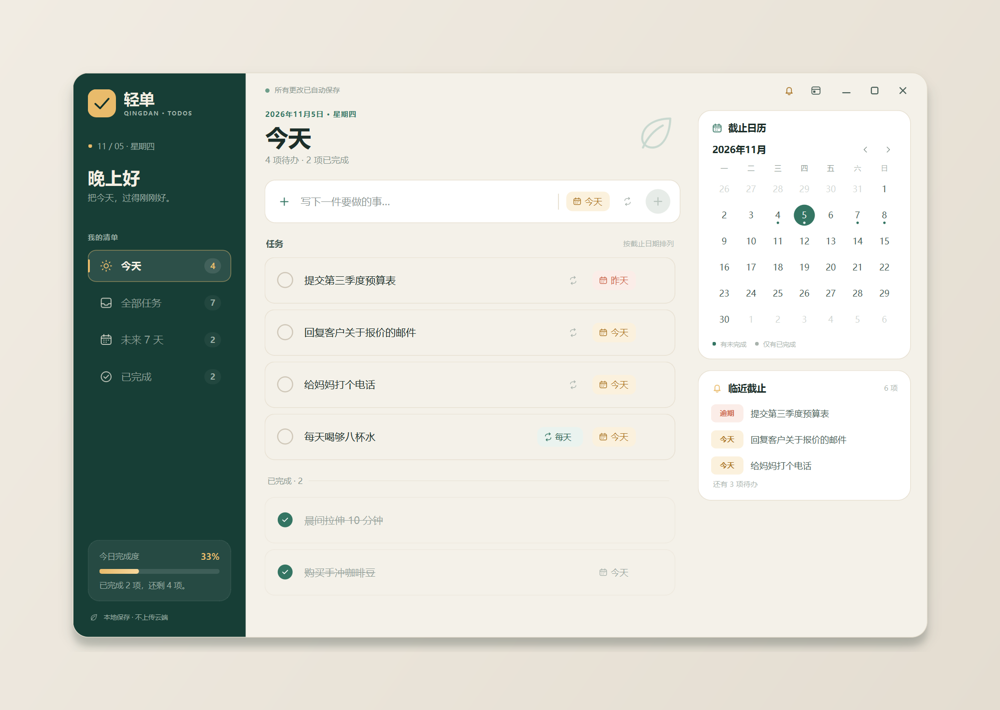
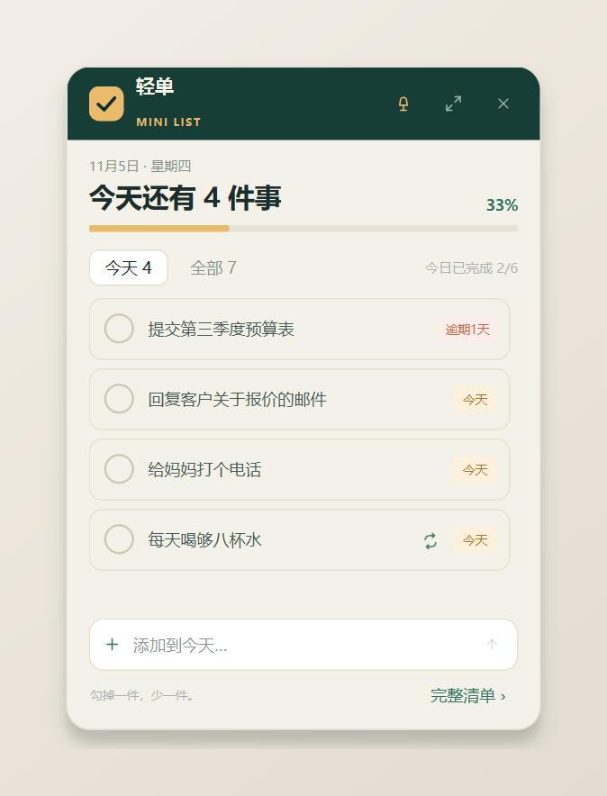
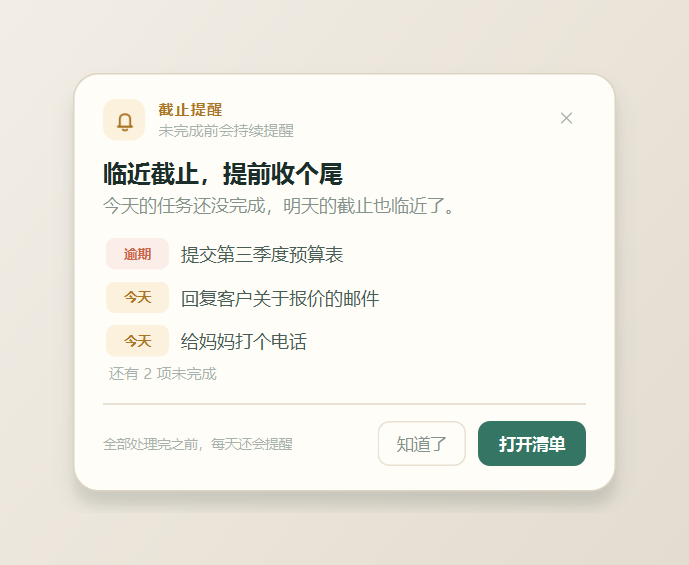

# 轻单 · Qingdan 1.2.0

一个安静、轻巧的 Windows 桌面待办清单。把今天要做的事放在一起，勾掉一件，日历会记得。



<table>
  <tr>
    <td></td>
    <td></td>
  </tr>
</table>

## 功能

- **勾选完成**：点击任务左侧的圆圈即可完成或取消完成；「今日完成度」和完成进度条实时更新。
- **截止日期**：新增或编辑任务时可设置截止日期，支持「今天 / 明天 / 下周一」快捷选择，也可以直接从月历中挑选任意日期。
- **重复事项**：支持每天、工作日、每周、每月四种重复规则；完成一次后会自动生成下一次，并保留本次完成记录。错过的周期会自动跳过，不会堆积一串逾期任务。
- **截止提醒**：默认开启。每天 **09:00** 汇总今天和已逾期但未完成的任务；**20:00** 提醒明天到期的任务。逾期任务和下一次重复事项都会继续参与提醒。
- **迷你窗口**：主窗口右上角的小窗按钮或 `Ctrl + M` 打开。置顶显示今天的待办，可勾选完成、快速添加、切换「今天 / 全部」，也可以随时展开回完整清单。
- **逾期提示**：截止日期为今天、明天、已逾期时会显示不同颜色；右侧「临近截止」会自动列出最近的待办。
- **多种查看方式**：今天、全部任务、未来 7 天、已完成；点击右侧日历中的任意日期，可直接筛选当天截止的事项。
- **轻量编辑**：双击任务标题修改内容；悬停任务时出现删除按钮；点击日期标签随时改截止日期。
- **本地自动保存**：每次改动立即写入本机 JSON，无需登录、无网络依赖，也不会把任务上传到云端。
- **无边框窗口**：自绘圆角窗口和顶部操作区，自动保存窗口位置与大小，支持最小化、最大化和边缘缩放。

> 截止提醒需要轻单正在运行（最小化、被其他窗口挡住或停留在迷你窗口时都可以）。关闭程序后不会再弹出系统通知。

## 直接运行

解压 `dist\Qingdan-Windows-v1.2.0.zip`，双击 `Qingdan\Qingdan.exe`。

> `Qingdan.exe` 旁边的 `_internal` 文件夹是程序的一部分，请保留整个 `Qingdan` 文件夹，不要只单独复制 exe。

## 从源码运行

需要 Windows 10/11 和 Python 3.11+。

```powershell
cd qingdan
py -3.11 -m venv .venv
.\.venv\Scripts\python.exe -m pip install -r requirements.txt
.\.venv\Scripts\python.exe main.py
```

也可以：

```powershell
.\.venv\Scripts\python.exe -m qingdan
```

## 使用

| 操作 | 方法 |
| --- | --- |
| 添加任务 | 在顶部输入内容，按 `Enter` 或点击右侧 `+` |
| 设置截止日期 | 点击输入框右侧的日期按钮；新任务默认使用当前视图的日期 |
| 修改截止日期 | 点击任务右侧的日期标签；也可以点击「清除」取消截止日期 |
| 设置重复 | 点击任务右侧的循环图标，或输入框里的循环图标，选择每天 / 工作日 / 每周 / 每月 |
| 完成任务 | 点击任务左侧的圆圈；已完成的任务会进入列表下方的「已完成」区域 |
| 修改标题 | 双击任务标题，按 `Enter` 保存，按 `Esc` 取消 |
| 删除任务 | 鼠标悬停在任务上，点击右侧垃圾桶图标 |
| 按日期查看 | 点击右侧日历中的日期；点「回到今天」返回 |
| 打开迷你窗口 | 点顶部的小窗图标，或按 `Ctrl + M` |
| 关闭提醒 | 点顶部的铃铛图标，取消勾选「截止提醒」 |
| 置顶迷你窗口 | 点迷你窗口标题栏的图钉按钮 |
| 移动窗口 | 拖动顶部状态栏空白区域；迷你窗口拖动深绿色标题栏 |
| 缩放窗口 | 拖动主窗口边缘 |
| 最大化 / 还原 | 双击顶部状态栏，或点击右上角方形按钮 |

### 截止提醒规则

| 时间 | 提醒内容 |
| --- | --- |
| 每天 09:00 | 今天到期和已经逾期的未完成任务 |
| 每天 20:00 | 明天到期的未完成任务 |

- 提醒以一张置顶小卡片出现在屏幕右下角，不抢当前输入焦点。
- 到达提醒时间时如果程序正在运行，会立即提醒；如果程序晚些启动，也会补上当前时段尚未提醒过的任务。
- 同一个时段每天只提醒一次；被提醒的任务只要没完成，后续日期的逾期提醒会继续出现。
- 可以在主窗口右上角铃铛菜单里关闭提醒、重新开启，或预览提醒样式。

### 重复事项规则

- 重复规则需要截止日期作为起点；选择重复时会自动补上今天作为截止日期。
- 完成任务时，本次会自动进入「已完成」，并生成下一次任务。下一次日期按原计划向后推进。
- 如果这次完成时已经逾期，下一次会推进到今天之后，避免生成一串过去的日期。
- 勾选完成后又取消勾选，会同时收回尚未完成的下一项，方便误操撤销。
- 清除重复事项的截止日期时，重复规则也会一起关闭。

### 快捷键

| 快捷键 | 功能 |
| --- | --- |
| `Ctrl + N` | 聚焦到新任务输入框 |
| `Ctrl + M` | 打开 / 收起迷你窗口 |
| `Ctrl + 1` | 今天 |
| `Ctrl + 2` | 全部任务 |
| `Ctrl + 3` | 未来 7 天 |
| `Ctrl + 4` | 已完成 |
| `Enter` | 添加任务 |
| `Esc` | 取消正在编辑的任务标题 |

## 数据保存在哪里

优先使用便携数据目录，任务和窗口设置都保存在程序旁边：

```text
Qingdan\
  Qingdan.exe
  _internal\
  data\
    tasks.json
    settings.ini
```

这样整个 `Qingdan` 文件夹可以直接搬走，不会把数据留在系统里。如果程序所在文件夹不可写，程序会自动依次尝试 `%LOCALAPPDATA%\Qingdan`、`%APPDATA%\Qingdan`、`Documents\Qingdan` 和系统临时目录，确保不会因为权限问题无法启动。

如需指定目录，可设置环境变量 `QINGDAN_DATA_DIR`。任务数据采用原子写入；如果 JSON 文件损坏，程序会先把原文件备份为 `tasks.corrupt-时间戳.json`，再以空清单启动，避免覆盖原始数据。

## 开发与测试

```powershell
.\.venv\Scripts\python.exe -m pytest -q
```

测试覆盖任务存储、过滤排序、日期标签、完成度、提醒时段与去重、迷你窗口交互、UI 添加/勾选/修改日期/日历筛选等。

## 打包

```powershell
.\build.ps1
```

默认使用仓库根目录的 `.venv`，产物为：

```text
dist\Qingdan\Qingdan.exe
dist\Qingdan-Windows-v1.2.0.zip
```

## 技术栈

- PySide6（Qt 6）纯桌面渲染，自绘图标、复选框、日历、迷你窗口和提醒卡片
- Python 3.11
- 轻量 JSON 本地存储，无数据库、无网络请求
